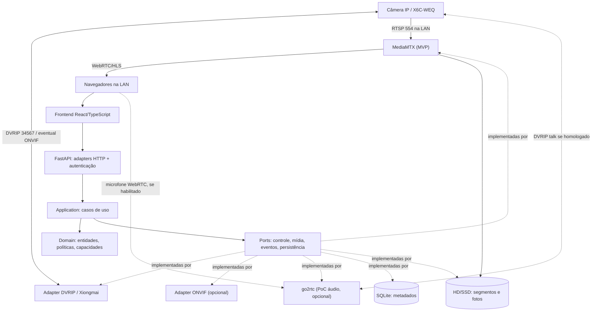
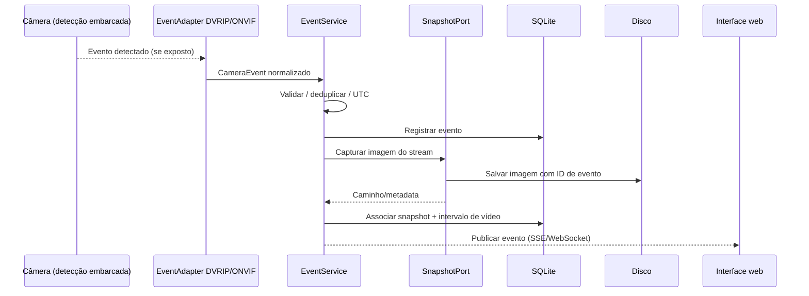

# Proposta de projeto — NVR Local Multiplataforma

**Versão:** 1.0 — 17/10/2026  
**Estado:** proposta técnica para orientar implementação com agente de LLM  
**Tipo:** aplicação self-hosted, local-first, com servidor HTTP e interface web  
**Primeiro equipamento-alvo:** câmera IP compatível com iCSee/Xiongmai, identificada como `X6C-WEQ` (firmware reportado `V5.00.R02.000807DD`)  
**Ambientes-alvo:** Linux e Windows, com acesso por navegadores desktop e móveis na rede local

> **Instrução ao agente implementador:** leia esta proposta integralmente antes de modificar o código. Trate como requisitos as seções de objetivos, princípios, contratos, critérios de aceite e segurança. Trate como hipóteses as capacidades específicas do firmware e as integrações que ainda não foram testadas. Não simule uma funcionalidade como operacional quando a câmera real não a suporta. Comece por uma prova de conceito verificável e mantenha o usuário informado sobre decisões de arquitetura.

---

## 1. Visão geral

Construir um **sistema NVR (Network Video Recorder) local**, de código modular e extensível, que:

1. Receba vídeo e áudio de câmeras IP na rede local, inicialmente por **RTSP**.
2. Grave continuamente ou conforme regras configuráveis em disco do servidor, **sem exigir upload à nuvem**.
3. Disponibilize uma **interface web responsiva** para visualização ao vivo, reprodução e download de gravações, eventos e administração das câmeras.
4. Reproduza, sempre que o equipamento suportar, funções presentes no aplicativo iCSee: **PTZ**, modos diurno/noturno, iluminação, detecção de movimento/pessoas, rastreamento, **push-to-talk**, snapshots e opções de automação embarcadas.
5. Funcione no **Windows e Linux**, inclusive em máquina dedicada, mini-PC ou servidor doméstico.
6. Permita incorporar **novos protocolos, modelos de câmera, mecanismos de gravação e estratégias de detecção** sem reescrever regras de negócio nem interface.

O sistema deverá funcionar na LAN mesmo que a conexão de internet esteja indisponível. Isso **não garante** que todo firmware de câmera deixe de fazer conexões externas; o projeto não deve depender dessas conexões para suas próprias funcionalidades.

### 1.1 Contexto da câmera inicialmente disponível

- IP LAN observado nos testes: `10.0.0.210` (**exemplo de ambiente; pode mudar por DHCP**).
- Portas TCP que responderam: `554` (candidata RTSP), `80` (interface web), `8899` (possível ONVIF) e `34567` (provável DVRIP/Xiongmai).
- **Transmissão de vídeo por RTSP já foi comprovada pelo usuário no VLC com credenciais locais recuperadas.**
- O modelo/firmware foi visto na interface do iCSee. A associação de **todas as funções e portas a protocolos específicos ainda precisa de testes**.
- O usuário informa que a câmera já realiza algumas automações de detecção e luz noturna; é uma **hipótese de capacidade**, não um contrato da API.
- O acesso local deve usar **usuário/senha do dispositivo**, que não são necessariamente o e-mail e a senha da conta do aplicativo iCSee.
- **Não colocar credenciais reais, URL RTSP completa ou dados sensíveis da câmera no repositório, logs, documentação, screenshots de testes ou prompts.**

## 2. Objetivos, escopo e prioridades

### 2.1 Escopo do MVP (obrigatório)

- Cadastrar ao menos uma câmera RTSP manualmente (nome, IP/host, porta, canal, stream, credenciais armazenadas com proteção).
- Verificar conectividade e mostrar estado (`online`, `offline`, `degraded`, `auth_error`).
- Gravar em disco local em segmentos com rotação, limites de retenção e tratamento básico de queda/retorno da conexão.
- Exibir transmissão ao vivo no navegador pela LAN, sem exigir o iCSee nem plugin de navegador.
- Listar e reproduzir gravações por câmera, data e faixa de horário.
- Exibir consumo de armazenamento, status de gravação e mensagens claras de erro.
- Proteger interface e APIs com autenticação local.
- Executar em Linux e Windows, com procedimentos documentados e testes automatizados.

### 2.2 Funcionalidades posteriores (não bloqueiam MVP)

- **Controle PTZ:** esquerda/direita, cima/baixo, diagonais se compatíveis; parar ao soltar o botão; presets e eventual zoom.
- **Imagem e iluminação:** modo dia/noite/automático, infravermelho, luz branca, intensidade/duração e rastreamento automático, conforme capacidades reais.
- **Eventos:** consumir detecção de movimento/pessoa fornecida pela própria câmera; registrar eventos com origem, tipo e horário.
- **Snapshot por evento:** capturar frame/thumbnail no servidor após detecção e associar ao evento e à gravação.
- **Automações embarcadas:** disponibilizar controles para ativar/configurar regras que a câmera executa autonomamente, como acender a luz em detecção noturna.
- **Push-to-talk:** microfone do navegador → servidor → alto-falante da câmera, com botão pressionar-para-falar.
- Múltiplas câmeras, múltiplos usuários/perfis, notificações locais, descoberta ONVIF/DVRIP e câmera(s) de outros fabricantes.
- Detecção no servidor (Frigate/outro serviço) **somente se** a câmera não expuser eventos adequados e houver recursos computacionais suficientes.

### 2.3 Fora do escopo inicial

- Serviço em nuvem, conta externa obrigatória, acesso pela internet aberto ao público.
- Aplicativos Android/iOS nativos (a web responsiva substitui essa necessidade inicial).
- Firmware customizado, exploração de credenciais, contorno de autenticação ou modificação do firmware.
- Reconhecimento facial, identificação de pessoas específicas e automação invasiva.
- Garantia de funcionamento de comandos proprietários não testados no hardware.

## 3. Requisitos funcionais

| ID | Requisito | Prioridade | Observação |
|---|---|---|---|
| RF-01 | Cadastrar, editar e desabilitar câmeras | MVP | Configuração isolada da camada de vídeo |
| RF-02 | Validar RTSP e descobrir codecs | MVP | Diagnóstico sem revelar senha |
| RF-03 | Visualização ao vivo na web | MVP | WebRTC prioritário; HLS como alternativa |
| RF-04 | Gravação contínua e persistente | MVP | Segmentos em disco, sem recodificar quando possível |
| RF-05 | Buscar, reproduzir e baixar gravações | MVP | Consulta por intervalo de tempo |
| RF-06 | Política de retenção e saúde do disco | MVP | Não apagar arquivos abertos/incompletos |
| RF-07 | Recuperar automaticamente a captura após falhas | MVP | Backoff, logs e estado visível |
| RF-08 | Autenticação local para painel e serviços | MVP | Sem exposição anônima de vídeos |
| RF-09 | PTZ em tempo real | Fase 2 | DVRIP primeiro, ONVIF se suportado |
| RF-10 | Selecionar modos diurno/noturno/IR/luz branca | Fase 2 | Capacidade e valores reais por câmera |
| RF-11 | Habilitar/configurar rastreamento e alarmes embarcados | Fase 2 | Preferir configuração da câmera |
| RF-12 | Registrar alarmes de movimento/pessoa | Fase 3 | Suporte ao protocolo deve ser verificado |
| RF-13 | Capturar snapshot e relacionar ao evento/gravação | Fase 3 | Imagem salva no servidor |
| RF-14 | Push-to-talk bidirecional | Fase 4 | Exige PoC DVRIP + WebRTC/HTTPS |
| RF-15 | Adicionar câmera ONVIF ou outro fabricante | Fase 5 | Interface única com adaptadores |
| RF-16 | Mostrar quais controles são suportados pela câmera | Fase 2 | Nunca expor botões falsamente operacionais |

### 3.1 Requisitos não funcionais

- **Offline-first:** captura, gravação, reprodução e administração devem funcionar sem internet após instalação e inicialização do ambiente local.
- **Portabilidade:** código comum Linux/Windows; caminhos via abstrações de sistema de arquivos; sem comandos shell específicos na regra de negócio.
- **Baixo custo computacional:** priorizar remux/stream copy, evitando decodificação e transcodificação sem necessidade.
- **Persistência:** gravação não depende de um navegador estar aberto; falhas e reinicializações não devem eliminar segmentos já finalizados.
- **Segurança e privacidade:** controle de acesso, proteção de segredos, comunicação criptografada na UI e nenhuma abertura automática de porta WAN.
- **Extensibilidade:** cada fabricante/protocolo tem um adaptador; regras de armazenamento e eventos não sabem o que é DVRIP ou ONVIF.
- **Observabilidade:** estado de conexões, espaço disponível, erros de login, latência de stream, eventos e falhas de gravação.
- **Testabilidade:** simuladores/fakes das portas, testes de integração com serviços reais e testes de hardware opcionais.

## 4. Decisão arquitetural: monólito modular com portas e adaptadores

Adotar **arquitetura hexagonal (Ports & Adapters)** no backend, com **separação por módulos de negócio**, organizada como um **monólito modular** em vez de microserviços próprios desde o início. Os serviços especializados de mídia podem rodar como processos externos.

A arquitetura deve usar os seguintes limites:

- **Domain:** conceitos e invariantes (câmera, capacidade, evento, gravação, política de retenção). **Sem dependência de FastAPI, SQLAlchemy, FFmpeg, DVRIP, ONVIF ou MediaMTX.**
- **Application / Use cases:** orquestram operações; dependem apenas de interfaces (`ports`) e entidades do domínio.
- **Adapters (outbound):** implementam portas: Xiongmai/DVRIP, ONVIF, MediaMTX, go2rtc, SQLite, disco, FFmpeg, armazenamento de segredos.
- **Adapters (inbound):** HTTP REST, WebSocket/SSE de eventos, jobs, CLI e testes; validam entrada e invocam casos de uso.
- **Frontend:** UI separada, com cliente tipado da API; nunca contém lógica de protocolo nem credenciais de câmera.
- **Media services:** streaming/recorder externos com configurações próprias, isolados de regras de negócio por `LiveStreamPort`/`RecordingPort`.

**Regra principal de dependência:** `HTTP/Jobs -> Application -> Ports/Domain` e `Adapters -> Ports`. O núcleo não importa adaptadores.

### 4.1 Diagrama de componentes



**Observação de implantação:** as ligações do diagrama são responsabilidades lógicas, não obrigação de abrir cada serviço ao usuário. O painel deverá usar um reverse proxy/autenticação e restringir os endpoints administrativos/streaming.

### 4.2 Módulos do backend

1. **Cameras:** cadastro, credenciais por referência, conectividade, capabilities, seleção de adapter.
2. **Streaming:** obtenção de sessão de vídeo, perfil main/substream, diagnóstico de codec e endpoint do player.
3. **Recordings:** ativação de gravação, índice de intervalos, reprodução, retenção e estado do disco.
4. **Camera controls:** PTZ, presets, iluminação, IR, modos e opções embarcadas, mediante suporte do dispositivo.
5. **Detections / Events:** subscrição ou polling de eventos, deduplicação, timestamps, histórico e snapshots.
6. **Talk:** início/parada de sessão de microfone, arbitragem de uso, timeout e erro (somente fase avançada).
7. **Identity / Security:** usuários do painel, sessões, autorização e segredos da integração.
8. **System:** saúde dos componentes, logs, políticas gerais e configuração.

Cada módulo pode ter `domain/`, `application/`, `ports/`, `adapters/` de acordo com sua complexidade, sem duplicar camadas vazias. Não transformar cada entidade em microserviço.

### 4.3 Contratos de porta (exemplo conceitual em Python)

```python
from dataclasses import dataclass
from enum import Enum
from typing import Protocol, AsyncIterator

class CameraFeature(str, Enum):
    PTZ = "ptz"
    PRESETS = "presets"
    NIGHT_MODE = "night_mode"
    WHITE_LIGHT = "white_light"
    HUMAN_EVENTS = "human_events"
    MOTION_EVENTS = "motion_events"
    EMBEDDED_LIGHT_AUTOMATION = "embedded_light_automation"
    TWO_WAY_AUDIO = "two_way_audio"

@dataclass(frozen=True)
class CameraCapabilities:
    supported: frozenset[CameraFeature]
    # Valores/modos aceitos também devem ser consultados/validados, não presumidos.

class CameraControlPort(Protocol):
    async def get_capabilities(self, camera_id: str) -> CameraCapabilities: ...
    async def move(self, camera_id: str, direction: str, speed: float) -> None: ...
    async def stop(self, camera_id: str) -> None: ...
    async def set_night_mode(self, camera_id: str, mode: str) -> None: ...
    async def set_white_light(self, camera_id: str, enabled: bool) -> None: ...

class EventSourcePort(Protocol):
    def subscribe(self, camera_id: str) -> AsyncIterator["CameraEvent"]: ...

class LiveStreamPort(Protocol):
    async def get_playback_descriptor(self, camera_id: str, profile: str) -> "PlaybackDescriptor": ...

class RecordingPort(Protocol):
    async def set_recording(self, camera_id: str, enabled: bool) -> None: ...
    async def list_intervals(self, camera_id: str, start_utc: str, end_utc: str) -> list["RecordingInterval"]: ...

class SnapshotPort(Protocol):
    async def capture(self, camera_id: str, event_id: str | None) -> "Snapshot": ...
```

Esse contrato é ilustrativo: **não implementar as assinaturas sem refinar erros, validações, estados e modelos de retorno**. Em particular, `UnsupportedFeature`, `CameraOffline`, `AuthenticationFailed`, `OperationTimeout` e `ResourceBusy` devem ser erros de aplicação bem definidos, não exceções espalhadas do SDK.

Para PTZ, parar ao soltar o controle é obrigatório: adicionar `stop` em `pointerup`, `pointercancel`, perda de foco e watchdog no backend. Nunca permitir movimentação indefinida após perda de rede.

### 4.4 Padrão de capacidades (*capability-driven UI*)

Uma câmera pode não ter zoom, modo de luz ou áudio bidirecional. A API deverá retornar capacidades descobertas e verificadas, por exemplo:

```json
{
  "cameraId": "cam_001",
  "capabilities": {
    "ptz": { "supported": true, "directions": ["up", "down", "left", "right"] },
    "nightMode": { "supported": "unknown", "availableModes": [] },
    "humanEvents": { "supported": "unknown" },
    "twoWayAudio": { "supported": "unknown" }
  }
}
```

Valores de exemplo, **não uma descoberta real**. Diferenciar `supported`, `unsupported` e `unknown/not_tested`; não inferir capacidade somente porque a porta está aberta.

## 5. Pipeline de mídia e gravações

### 5.1 MVP: usar uma única pilha de mídia

**Recomendação inicial: MediaMTX como ingest RTSP, retransmissão WebRTC/HLS e gravação.** Evita construir pipeline próprio de codecs e reduz o número de processos/conexões.

```text
Câmera --RTSP pela LAN--> MediaMTX
                                |--> WebRTC / HLS --> navegador
                                |--> segmentos fMP4/MPEG-TS --> disco
                                |--> endpoint de listagem/reprodução de gravações

Backend FastAPI --> MediaMTX (API protegida) e SQLite (metadados da aplicação)
```

- Preferir usar codecs diretamente, sem recodificação. Verificar se o vídeo sai H.264/H.265 e áudio PCMA/AAC; o suporte no navegador varia. Se WebRTC falhar com H.265, avaliar substream H.264 ou **transcodificação opcional** no servidor.
- Separar **reprodução ao vivo** de **consulta ao histórico**; ambos operam sem que o navegador controle o processo de gravação.
- O mecanismo de gravação precisa persistir enquanto o serviço está ativo, reconectar após queda de câmera e registrar gaps.
- Registrar no banco só **metadados**, não grandes blobs de vídeo.
- Usar segmentos de duração configurável. Não pressupor corte exato em cada minuto nem segmentos reproduzíveis antes de finalizados.
- MediaMTX suporta `recordDeleteAfter`; criar uma política complementar por **espaço disponível**, exclusiva do módulo de retenção, se necessário.

### 5.2 Extensão futura: go2rtc para talk

O **go2rtc** dá suporte documentado a DVRIP e áudio bidirecional em alguns modelos. Entretanto, **a compatibilidade com a X6C-WEQ ainda precisa ser validada**. Avaliar em PoC se:

1. o go2rtc consegue autenticar na câmera usando credenciais locais;
2. aceita enviar áudio do navegador ao alto-falante via DVRIP;
3. há canal/codec adequado e a câmera não bloqueia sessões concorrentes;
4. vale substituir o componente de live view por go2rtc ou deixá-lo **restrito ao áudio**, mantendo MediaMTX como gravador.

**Evitar duas capturas RTSP independentes da câmera sem necessidade.** Se go2rtc passar a ser o hub principal, testar o cenário `câmera -> go2rtc -> restream RTSP local -> MediaMTX (gravação)` antes de adotá-lo; verificar comportamento com áudio, perda de sessão e reconexão. Essa topologia é uma **opção a validar**, não decisão irreversível.

### 5.3 Capacidade de armazenamento

Estimativa para **uma câmera**, 24 h/dia:

`GB/dia (aprox.) = bitrate_em_Mbps × 10,8`

Ex.: 2 Mbps ≈ 21,6 GB/dia; 7 dias ≈ 151,2 GB, desconsiderando overhead e variações do stream. Para N câmeras, somar os bitrates. Permitir limites por câmera e exibir estimativas, mas medir bitrate real em produção.

## 6. Controles, automações e eventos da câmera

### 6.1 Adaptadores e seleção

- **DVRIP/Xiongmai:** prioridade para hardware iCSee. Reutilizar ideias e, se licenciado e adequado, componentes isolados de `icsee-ptz`. Não depender da execução de uma instância inteira do Home Assistant.
- **ONVIF:** segunda via para recursos padronizados (descoberta, perfil de mídia, PTZ, eventos) **se o endpoint e serviços forem confirmados**.
- **Sem suporte:** operação devolve erro específico e UI desabilita/oculta controle; a experiência não pode fingir que executou comando.

Usar mapeamento por `CameraAdapterFactory`/registro de drivers, com escolha explícita ou detecção confiável. Não condicionar as regras de negócio a `if vendor == "xiongmai"` em diversos módulos.

### 6.2 Matriz de implementação e validação

| Recurso | Primeira tentativa | Alternativa/fallback | Como validar no dispositivo |
|---|---|---|---|
| PTZ / stop | DVRIP (`icsee-ptz`) | ONVIF PTZ | Movimento visível e parada imediata |
| Presets | DVRIP | ONVIF | Salvar/retornar a posição após movimentar |
| IR / modo noturno | Configuração DVRIP | ONVIF Imaging, se disponível | Ler valor antes/depois e observar imagem |
| Luz branca | DVRIP | Nenhuma garantia padronizada | Acionamento físico e leitura de estado |
| Luz ao detectar pessoa à noite | Configuração embarcada DVRIP | Regra no servidor **somente se suportada** | Teste noturno controlado, sem alterar regras existentes antes |
| Rastreamento automático | Configuração DVRIP | Nenhum fallback universal | Testar detecção/movimento/retorno à posição |
| Detecção de pessoa/movimento | Alarmes/eventos DVRIP | ONVIF Events; Frigate opcional | Gerar evento real e analisar payload/timestamp |
| Snapshot de evento | Frame do stream no servidor | Endpoint snapshot ONVIF/da câmera | Confirmar imagem associada ao evento |
| Push-to-talk | go2rtc DVRIP | Adaptador próprio baseado em referência de protocolo | Voz inteligível e interrupção ao soltar botão |

**Regra de negócio:** quando a câmera já consegue acender a luz automaticamente ao detectar presença, **preferir configurar e preservar a automação embarcada**. A interface deve administrar esses parâmetros; o servidor não deve duplicar ações que gerem piscadas, conflitos, múltiplos comandos ou comportamento imprevisível. Snapshot no servidor é uma ação adicional independente.

### 6.3 Fluxo de detecção e snapshot



Distinguir `motion_detected` de `person_detected`: **não classificar como pessoa um evento que sinaliza apenas movimento**. Usar IDs gerados, cooldown/deduplicação configurável, timezone consistente e marcação de confiança/origem quando fornecida. Se o evento vier atrasado, salvar o frame disponível e registrar a diferença temporal; não afirmar que é o instante exato da detecção.

### 6.4 Push-to-talk

- Microfone via `getUserMedia()` no navegador e envio via WebRTC/backend de mídia.
- Para outros dispositivos da LAN, servir a aplicação em **HTTPS com certificado confiável**, necessário ao acesso ao microfone (a exceção de `localhost` não serve para um telefone que acessa IP da LAN via HTTP).
- Botão **pressionar para falar**, indicação de sessão ativa e **parada garantida** se botão solto, página fechada ou conexão perdida.
- Restringir a **uma sessão ativa por câmera** inicialmente; autenticar/autorizar esse controle.
- Investigar codecs aceitos pela câmera (ex.: G.711 A-law/PCMA) e evitar envio de áudio a terceiros.
- O áudio bidirecional **não é requisito bloqueante do MVP**; primeiro validar hardware com go2rtc ou um protótipo de protocolo.

## 7. API HTTP e eventos (contrato inicial proposto)

Versionar em `/api/v1`, com autenticação e contratos OpenAPI gerados. Exemplos:

| Método | Endpoint | Responsabilidade |
|---|---|---|
| `POST` | `/api/v1/auth/login` | Criar sessão no painel |
| `GET` | `/api/v1/cameras` | Listar câmeras e estado |
| `POST` | `/api/v1/cameras` | Cadastrar câmera |
| `GET` | `/api/v1/cameras/{id}/capabilities` | Suporte de recursos por câmera |
| `POST` | `/api/v1/cameras/{id}/test` | Testar conexão/credenciais |
| `GET` | `/api/v1/cameras/{id}/live` | Obter descritor/URL temporária do player |
| `POST` | `/api/v1/cameras/{id}/ptz/move` | Iniciar movimento autorizado |
| `POST` | `/api/v1/cameras/{id}/ptz/stop` | Parar movimento imediatamente |
| `GET/PUT` | `/api/v1/cameras/{id}/night-mode` | Consultar/alterar modo suportado |
| `GET/PUT` | `/api/v1/cameras/{id}/lighting` | Consultar/alterar luz |
| `GET/PUT` | `/api/v1/cameras/{id}/embedded-automations` | Ler/salvar opções embarcadas |
| `GET` | `/api/v1/recordings?cameraId=&start=&end=` | Consultar intervalos gravados |
| `GET` | `/api/v1/events?cameraId=&type=&start=&end=` | Consultar eventos |
| `GET` | `/api/v1/events/stream` | SSE para eventos/status em tempo real |
| `POST` | `/api/v1/cameras/{id}/talk/sessions` | Abrir sessão autorizada de talk |
| `DELETE` | `/api/v1/cameras/{id}/talk/sessions/{sessionId}` | Encerrar sessão |
| `GET` | `/api/v1/system/health` | Estado agregado do sistema |

Evitar trafegar credenciais de câmera na resposta da API. URLs temporárias de mídia não podem expor senhas RTSP. Todas as ações de controle devem validar capacidade e autorização antes de invocar o protocolo.

## 8. Estrutura sugerida do repositório

```text
local-nvr/
├── README.md
├── docs/
│   ├── proposal.md                # esta proposta
│   ├── architecture.md            # diagramas + fronteiras
│   ├── decisions/                 # ADRs (decisões arquiteturais)
│   ├── compatibility/             # testes por modelo/firmware
│   └── operations/                # instalação, backup, atualização
├── apps/
│   ├── backend/
│   │   ├── pyproject.toml
│   │   ├── src/nvr/
│   │   │   ├── cameras/
│   │   │   ├── streaming/
│   │   │   ├── recordings/
│   │   │   ├── controls/
│   │   │   ├── events/
│   │   │   ├── talk/
│   │   │   ├── identity/
│   │   │   ├── system/
│   │   │   └── bootstrap/         # composition root / DI
│   │   └── tests/
│   └── web/
│       ├── src/features/
│       │   ├── cameras/
│       │   ├── live/
│       │   ├── recordings/
│       │   ├── events/
│       │   ├── controls/
│       │   └── settings/
│       └── tests/
├── integrations/
│   ├── mediamtx/                  # config de exemplo, sem senhas
│   ├── go2rtc/                    # apenas após PoC
│   └── fixtures/                  # dados sintéticos / fake camera
├── infra/
│   ├── docker/
│   ├── linux/
│   └── windows/
├── scripts/
├── .env.example                   # placeholders, sem segredos
└── .gitignore
```

**Importante:** essa árvore é uma organização de partida. O agente pode simplificar módulos não necessários no MVP, mas **não pode fundir domínio, protocolos e UI**. Criar `architecture.md` e um ADR ao escolher/alterar o pipeline de mídia.

## 9. Stack sugerida

| Papel | Opção recomendada | Justificativa / condição |
|---|---|---|
| Backend | Python 3.12+ + FastAPI | Async IO, tipagem, OpenAPI e integração com bibliotecas de câmera |
| Modelos/validação | Pydantic | Contratos de entrada/saída |
| Persistência | SQLite + SQLAlchemy/Alembic | Simplicidade para instalação doméstica; migrações versionadas |
| Interface | React + TypeScript | Componentes reutilizáveis e web responsiva |
| Dados remotos na UI | Cliente OpenAPI tipado | Contratos explícitos, sem adivinhação de payload |
| Media server MVP | **MediaMTX** | RTSP, WebRTC/HLS, gravação e playback |
| Áudio bidirecional avançado | **go2rtc** | DVRIP + WebRTC, após validação do hardware |
| Controle DVRIP | Adapter Python inspirado em `icsee-ptz` | PTZ, configurações e alarmes |
| Controle ONVIF | Cliente ONVIF Python, a avaliar | Alternativa padronizada se compatível |
| Proxy HTTPS | Caddy, opção avaliada | HTTPS local para push-to-talk e autenticação |
| Implantação | Binários/serviços nativos primeiro; Docker Compose como opção | Linux e Windows, sem presumir que rede Docker funciona igual nos dois sistemas |
| Testes | pytest, testes de contrato, Playwright | Testabilidade sem câmera e E2E |

**Por que não microserviços próprios?** Uma câmera e um servidor local não justificam distribuição de todo o domínio. O custo de operação, deployment e debugging aumentaria sem benefício imediato. MediaMTX/go2rtc são processos de terceiros especializados, não justificativa para dividir os casos de uso em serviços de rede independentes.

## 10. Projetos open source pesquisados e oportunidades de reaproveitamento

Os links abaixo foram consultados para esta proposta (17/10/2026). A documentação comprova capacidades **dos projetos**, não compatibilidade automática com a X6C-WEQ. Verificar release, licença, APIs e testes antes de integrar.

| Projeto | URL | Uso recomendado | Cuidados |
|---|---|---|---|
| **MediaMTX** | https://github.com/bluenviron/mediamtx | **Principal**: retransmissão RTSP→WebRTC/HLS, gravação e playback; API de controle | H.265/navegadores; proteção dos endpoints e retenção. Licença MIT indicada no repo. |
| **go2rtc** | https://github.com/AlexxIT/go2rtc | **PoC para push-to-talk DVRIP**; possível retransmissão de baixa latência | Confirmar áudio bidirecional com a câmera real e HTTPS no navegador. Licença MIT indicada no projeto. |
| **icsee-ptz** | https://github.com/dbuezas/icsee-ptz | **Principal referência DVRIP**: PTZ, presets, alarmes, luz, modos noturnos, configurações | É uma integração Home Assistant. Extrair/adaptar apenas o cliente/ideias necessários; recurso varia por firmware. Licença MIT. |
| **Icsee-android / iCSee Local Control** | https://github.com/voidnullvalue/Icsee-android | **Referência de protocolo** DVRIP, PTZ e push-to-talk (handshake/codec), estado de sessão | Implementado em Kotlin/Android; não importar diretamente como biblioteca Python. Testes em outro hardware. Licença MIT. |
| **Frigate** | https://github.com/blakeblackshear/frigate | Referência ou módulo opcional de detecção local, snapshots, eventos e retenção | Pode exigir maior CPU/GPU; não usar no MVP se a câmera já expõe eventos suficientes. Licença MIT do código. |
| **python-onvif-zeep** | https://github.com/FalkTannhaeuser/python-onvif-zeep | Referência de cliente ONVIF em Python | Avaliar manutenção/compatibilidade; habilitação ONVIF depende do firmware. Licença MIT. |
| **FFmpeg** | https://ffmpeg.org/ | Ferramenta de diagnóstico, screenshots, remux e eventual transcodificação | Não duplicar função de gravação sem necessidade. Verificar licenciamento de build distribuída. |

### 10.1 Documentação técnica mais relevante

- MediaMTX — gravação: https://mediamtx.org/docs/features/record
- MediaMTX — playback: https://mediamtx.org/docs/features/playback
- MediaMTX — autenticação: https://mediamtx.org/docs/features/authentication
- MediaMTX — API de controle: https://mediamtx.org/docs/features/control-api
- go2rtc — DVRIP: https://github.com/AlexxIT/go2rtc/blob/master/internal/dvrip/README.md
- go2rtc — documentação/API: https://github.com/AlexxIT/go2rtc
- icsee-ptz — capacidades: https://github.com/dbuezas/icsee-ptz/blob/main/README.md
- icsee-ptz — cliente DVRIP: https://github.com/dbuezas/icsee-ptz/blob/main/custom_components/icsee_ptz/asyncio_dvrip.py
- Icsee-android — notas do protocolo: https://github.com/voidnullvalue/Icsee-android/blob/main/PROTOCOL_NOTES.md
- Icsee-android — status validado por hardware: https://github.com/voidnullvalue/Icsee-android/blob/main/PROTOCOL_STATUS.md
- Segurança do microfone no navegador: https://developer.mozilla.org/en-US/docs/Web/API/MediaDevices/getUserMedia
- Frigate — docs: https://docs.frigate.video/

**Licenciamento:** antes de copiar código, conferir a licença da **versão/commit efetivamente usados** e preservar avisos de copyright. Uso como processo externo, inspiração de arquitetura e incorporação de código são situações diferentes. Não supor que transcodificadores, codecs ou binários empacotados têm necessariamente a mesma licença do repositório principal.

## 11. Estratégia de desenvolvimento com agente de LLM

O desenvolvimento deve seguir **entregas verticais pequenas**, testáveis, e não construir todas as camadas abstratas de uma vez. Em cada fase, documentar problemas, decisões e evidências.

### Fase 0 — Descoberta de hardware (spikes curtos)

**Entregas:** `docs/compatibility/X6C-WEQ.md`, prova de leitura RTSP, lista de capacidades testadas, diagnóstico de codecs e tabela de riscos.

- Validar RTSP já conhecido com ferramenta reprodutível, sem imprimir credenciais.
- Testar endpoint ONVIF real; `8899` aberta não é prova suficiente.
- Usar testes controlados DVRIP para login, capacidades e leitura de configuração; **não alterar configurações no teste exploratório por padrão**.
- Medir bitrate/codecs, testar queda/reconexão do cabo LAN.
- Identificar se há detecção de pessoas, eventos acessíveis, controle de luz e PTZ.
- Criar relatório `supported / unsupported / unknown` por funcionalidade, com firmware e logs sanitizados.

### Fase 1 — MVP mídia e gravação

**Entregas:** serviço de vídeo funcionando, painel web mínimo, gravador contínuo, consulta/reprodução de histórico, autenticação local e instruções Windows/Linux.

1. Subir MediaMTX com RTSP de teste, sem app próprio.
2. Confirmar gravação sem navegador e player acessível em outro dispositivo da LAN.
3. Criar os modelos de câmera/gravação e ports da aplicação.
4. Adicionar adaptador MediaMTX/SQLite e API FastAPI.
5. Criar frontend com player, estado, timeline e listagem de arquivos.
6. Adicionar retenção, health check e reconexão.

### Fase 2 — Controle da câmera

**Entregas:** adapter DVRIP testado, PTZ, leitura/edição dos modos suportados, painel de controles condicionado a capabilities.

- Priorizar leitura de estados e confirmação explícita antes de mudanças com efeitos físicos.
- Guardar a configuração anterior no teste manual e oferecer restauração.
- Evitar acionar luz/alarme de madrugada sem confirmação do operador.

### Fase 3 — Eventos e snapshots

**Entregas:** adaptador de eventos, histórico filtrável e snapshots por detecção. Integrar a automação embarcada de luz se o firmware oferecer configuração documentada/validada.

- Se a câmera não expuser eventos confiáveis, registrar impedimento e propor alternativa (ONVIF Events/Frigate) em ADR; **não fabricar detecções**.

### Fase 4 — Push-to-talk

**Entregas:** protótipo go2rtc/DVRIP, áudio audível na câmera, experiência press-and-hold por HTTPS, gestão de sessões e falhas.

### Fase 5 — Extensibilidade e robustez

**Entregas:** segunda câmera/protocolo, testes de concorrência, empacotamento Docker opcional, backups e atualização, telemetria e documentação de operação.

### 11.1 Como o agente deve trabalhar em cada fase

1. **Investigar fontes**: documentar API/protocolo/versão concreta antes de escrever código.
2. **Propor plano pequeno**: arquivos a mudar, dependências, critérios de aceite, riscos.
3. **Implementar uma fatia vertical**: domínio/caso de uso/adaptador/API/UI somente quando necessários.
4. **Testar**: unitários, contrato e integração; testes de hardware com opt-in.
5. **Apresentar evidências**: comandos executados, resultados e limitações.
6. **Atualizar documentação/ADR**: registrar trade-offs e próximos passos.
7. **Não avançar com suposições**: quando depender de modelo/firmware, solicitar o teste físico adequado em vez de implementar comportamento inventado.

### 11.2 Restrições explícitas para o agente

- Não hardcode usuário/senha nem expor credenciais em URLs que vão ao navegador.
- Não usar cloud/iCSee oficial como dependência oculta.
- Não substituir a arquitetura por uma aplicação monolítica que contém código DVRIP em rotas HTTP ou componentes React.
- Não criar módulos, DI ou microserviços artificiais só para “parecer hexagonal”.
- Não executar factory reset, alterar senha, atualizar firmware, formatar cartão SD, mover PTZ ou ativar alarmes sem autorização específica do usuário.
- Não desabilitar autenticação, firewall ou verificações HTTPS para fazer o push-to-talk funcionar.
- Não declarar `done` para recursos sem teste de aceite.
- Não incluir gravações reais, vozes ou dados sensíveis no repositório de exemplo.

## 12. Testes e critérios de aceite

### 12.1 MVP

- [ ] O servidor inicia em **Linux e Windows** com configuração documentada.
- [ ] A câmera transmite via LAN e a UI abre em **outro dispositivo** da mesma rede.
- [ ] Ao fechar todos os navegadores, **a gravação continua**.
- [ ] Ao retirar a internet do roteador, **o NVR mantém operação LAN** (sem cortar a energia/rede interna).
- [ ] Ao derrubar a câmera e reconectá-la, o estado aparece corretamente e a gravação retoma automaticamente.
- [ ] Gravações finalizadas podem ser listadas, reproduzidas e baixadas por intervalo.
- [ ] Há política configurável de retenção e proteção contra disco cheio.
- [ ] Uma conta não autenticada não consegue assistir ao vídeo nem enumerar gravações/eventos.
- [ ] Segredos não constam de logs, Git, respostas públicas da API ou requests do navegador à câmera.
- [ ] Testes unitários/integração executam sem hardware usando fake adapters.

### 12.2 Controle, detecção e áudio (conforme suporte confirmado)

- [ ] PTZ move e **para mesmo ao perder pointer/foco**.
- [ ] Comandos de luz/modo noturno têm read-back e não alteram parâmetros não solicitados.
- [ ] Eventos de pessoa e movimento não são confundidos; há deduplicação.
- [ ] Snapshot tem timestamp, câmera, evento e arquivo válidos; o vídeo histórico é navegável a partir do evento.
- [ ] Desligar o backend não impede **automações embarcadas** da câmera, caso comprovadas.
- [ ] Push-to-talk opera a partir de um segundo dispositivo, por HTTPS, com autorização e encerramento seguro.
- [ ] Recursos não suportados aparecem como indisponíveis, com motivo, e não produzem falso feedback de sucesso.

### 12.3 Camadas de testes

- **Unitários:** domínio, políticas de retenção, erros, mapeamento de capabilities/eventos, auth.
- **Contratos:** fake adapters, respostas REST e esquema OpenAPI, comandos do driver e mocks do MediaMTX.
- **Integração:** serviço MediaMTX/go2rtc em ambiente de teste, SQLite, diretórios temporários e FFmpeg com vídeo sintético.
- **E2E:** Playwright para login, player, timeline, configurações e controles com câmera fake.
- **Hardware opcional:** suíte marcada `manual_camera` executada só com consentimento e credenciais locais de teste; logs sanitizados.
- **Resiliência:** queda LAN, reinício de processo, disco quase cheio, URL inválida, senha incorreta, codec não suportado e múltiplos espectadores.

## 13. Segurança e operação

1. **Credenciais do dispositivo:** guardar secret seguro no SO ou arquivo criptografado/serviço de segredo adequado ao ambiente; jamais retornar ao frontend. Um `.env` local com permissões restritas pode ser usado apenas no protótipo, com risco documentado.
2. **Credenciais do painel:** senhas com hash forte, sessões seguras, CSRF conforme modo de autenticação, CORS estrito, rate limiting e autorização por operação.
3. **Rede:** bind do painel somente a interfaces desejadas; firewall permitindo clientes LAN autorizados. Não configurar port forwarding/UPnP para WAN.
4. **HTTPS para dispositivos móveis:** usar hostname LAN com certificado confiável para recursos de microfone. Documentar como confiar no certificado com segurança; não instruir usuários a ignorar erros TLS.
5. **APIs de media server:** manter APIs administrativas, endpoints de playback brutos e serviços de controle em loopback/rede interna do container sempre que possível; acesso à mídia deve respeitar autorização do painel, inclusive URLs que podem ser copiadas.
6. **RTSP/DVRIP:** muitos dispositivos usam protocolos sem transporte criptografado; priorizar segmento de rede confiável/VLAN para câmeras.
7. **Privacidade:** gravações e snapshots são dados sensíveis; permitir exclusão controlada, política de retenção, backup opcional e registros de acesso essenciais.
8. **Inicialização automática:** serviço de sistema (systemd no Linux; serviço do Windows ou ferramenta equivalente) ou contêiner com reinício automático.
9. **Windows + Docker:** validar acesso LAN/WebRTC/UDP e bind mounts em Docker Desktop; evitar presumir equivalência com host networking Linux.
10. **Endereço da câmera:** oferecer IP fixo/reserva DHCP no roteador ou nome resolvível, sem hardcode na lógica de domínio.

## 14. Riscos e decisões em aberto

| Risco/pergunta | Impacto | Estratégia |
|---|---|---|
| X6C-WEQ expõe eventos de pessoa por DVRIP? | Define pipeline de eventos | PoC de alarmes com hardware |
| ONVIF realmente funciona em `8899`? | Adapter alternativo | Descoberta e consulta de serviços autenticada |
| Talk via DVRIP funciona nesta versão? | Recurso de microfone | PoC go2rtc e referência `Icsee-android` |
| Stream usa H.265 incompatível com navegador? | Preview ao vivo | Testar substream e transcodificação opcional |
| Interface precisa controlar automações embarcadas? | Conflito de regras | Ler configuração e oferecer escrita explícita |
| Permissões/HTTPS de mobile na LAN | PTT e segurança | Reverse proxy + certificado confiável |
| Windows e Linux têm caminhos/processos distintos | Portabilidade | Abstração e CI nos dois SOs |
| Como expor MediaMTX sem bypass de auth? | Vazamento de vídeo | Proteger proxy/URLs e validar integração de auth |
| Segundo fabricante/protocolo | Generalidade | Adaptadores e capacidades desde Fase 2 |

### ADRs iniciais a produzir

- **ADR-001:** monólito modular + ports/adapters vs microserviços.
- **ADR-002:** MediaMTX como motor único de mídia no MVP.
- **ADR-003:** estratégia de autenticação e autorização de streams.
- **ADR-004:** integração DVRIP (`icsee-ptz` adaptado ou implementação própria).
- **ADR-005:** go2rtc para áudio; decidir após PoC e não por suposição.
- **ADR-006:** modelo de armazenamento/índice/retention e recuperação de falhas.

## 15. Primeiro comando de trabalho sugerido ao agente

> Leia `docs/proposal.md`. Não implemente todo o produto ainda. Comece **apenas pela Fase 0 e pelo desenho executável da Fase 1**: (1) revise as referências MediaMTX, icsee-ptz e go2rtc; (2) confirme as versões e as licenças das dependências; (3) proponha uma estrutura mínima de repositório conforme os limites da arquitetura hexagonal, com interfaces explícitas e sem excesso de abstrações; (4) crie um ambiente de teste com vídeo sintético/RTSP e gravação local; (5) documente como testar no Windows e Linux e como configurar credenciais reais **fora do Git**; (6) prepare uma lista objetiva dos testes que dependem da câmera X6C-WEQ e aguarde autorização para comandos que alterem seu estado. Entregue primeiro uma prova de conceito de reprodução e gravação LAN, com logs sanitizados e critérios de aceite verificados.

---

### Resultado esperado

Um NVR local mantido por você, acessível pelo navegador de PCs e celulares, com gravação em disco e **painel extensível de capacidades das câmeras**. O núcleo não será dependente de um fabricante, da ferramenta de streaming ou de um único sistema operacional. As funcionalidades específicas da X6C-WEQ serão incorporadas conforme verificadas na câmera real — começando pelo RTSP, já confirmado, e avançando para PTZ, automações noturnas, eventos e push-to-talk.
